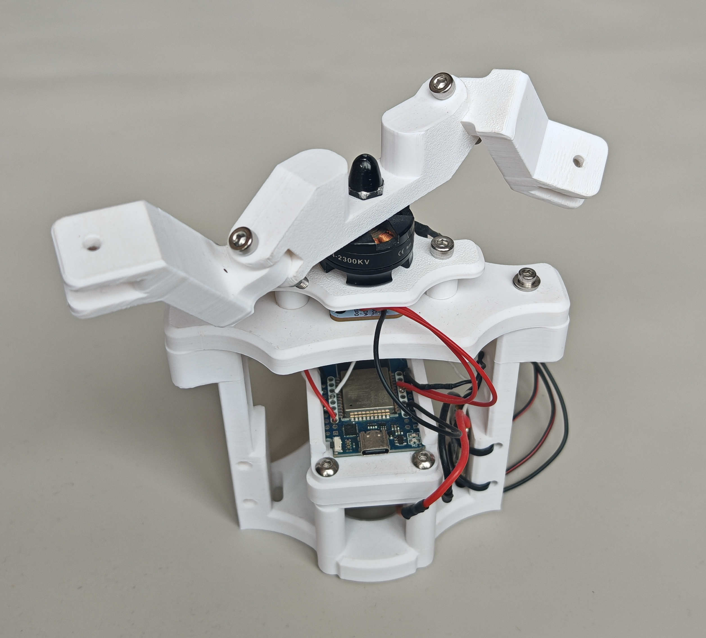
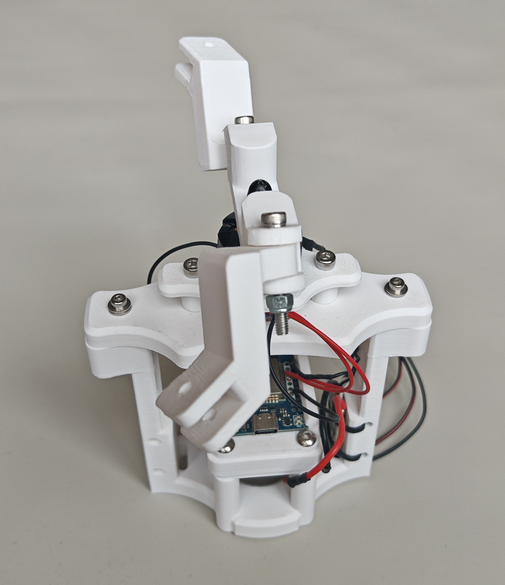
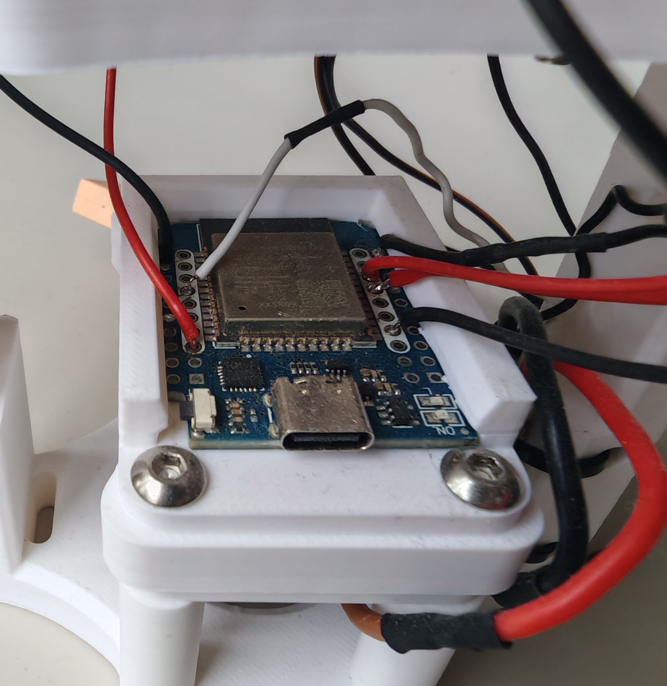
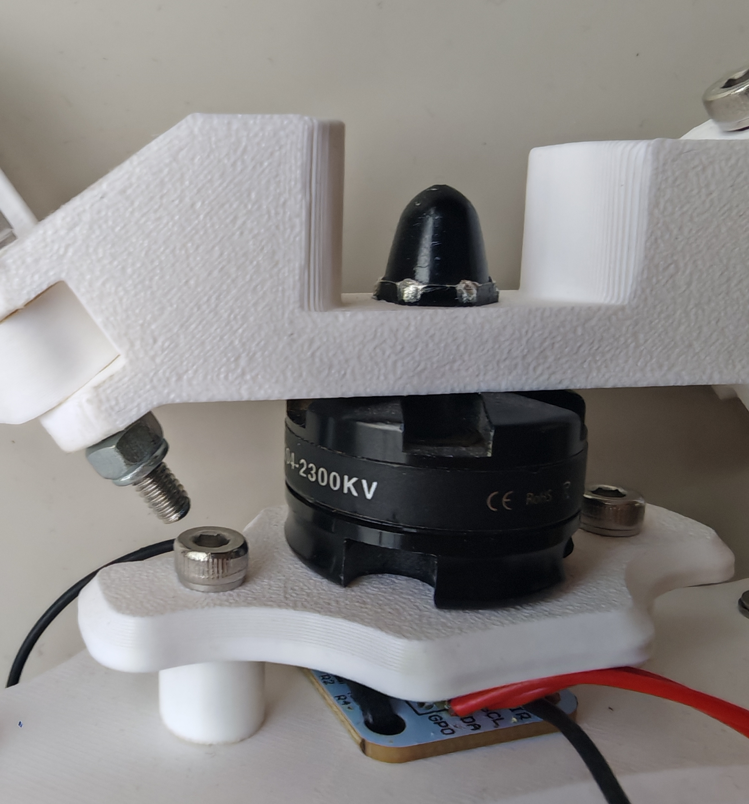

# FLY-Z #

#### Swashplateless coaxial drone ####

## Description ##
The goal of this project is to develop a drone powered only by two coaxial motors.

The major challenge in designing drones or vehicles in general is controllability, that is, how they move through space. Here are a few examples of control systems:

- Quadcopters adjust the speed of one or more of their motors to change direction.
- Helicopters use a swashplate to adjust the lift generated by the rotors.

Therefore, the goal of this project is to draw inspiration from swashplate technology to develop a mechanically less complex control system and apply it to a coaxial drone.

  
  

 
## General Idea ##

The general idea is to use the inertia of the propeller, which are allowed a degree of freedom in rotation around a specific axis.

Then, at a given position, the motor accelerates. 
This acceleration causes the blades to tilt, due to the principle of inertia.

This tilting of the blades creates a modification of lift : its increases on one side and a decreases on the other. Then causes the drone to tilt aswell.

## Tests ##

The control system is used only on the upper rotor; the lower rotor serves solely to compensate the reaction force.

Initial tests showed that the design of the `FLY_Z-CarterPortePales` part is critical.
In particular, the positioning of the principal axis of inertia must be aligned with the motor’s axis of rotation to prevent vibrations.

- `v1.0` : misaligned axis of inertia generate vibrations 

- `v1.1` : correction of rotor inertia

The system must be able to determine the motor’s angular position. To do this, a magnetic encoder is used (ref. `AS5600`)

The control board is an `ESP32`, chosen for its efficiency and its size (ref. `wemos esp32 d1 mini`)

     
     

## To Do ##

- Check for magnetic encoder capacity for high-frequency  

## References ##

- [Swashplateless Helicopter : Review](https://www.youtube.com/watch?v=Y31BhQToh_U)
- [Swashplateless Helicopter : Presentation](https://www.youtube.com/watch?v=d80oXSCcHTk)

